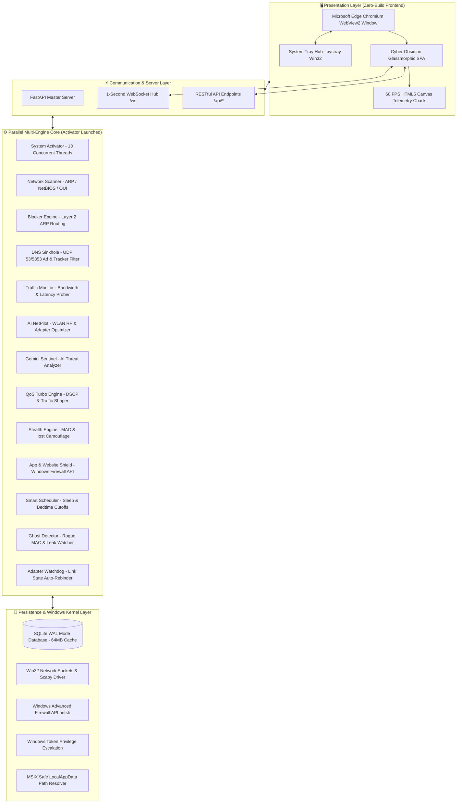

# ⚡ SwitchGate Internet — Master Project Guide & Architecture Documentation

> **Definitive Developer & Contributor Manual**  
> *A complete technical deep-dive into the architecture, engines, database, APIs, frontend, and build systems of SwitchGate Internet.*

---

## 📑 Table of Contents
1. [Executive Summary & Problem Statement](#1-executive-summary--problem-statement)
2. [High-Level System Architecture](#2-high-level-system-architecture)
3. [Full Project File Map & Directory Breakdown](#3-full-project-file-map--directory-breakdown)
4. [Deep Dive: The 13 Core Background Engines](#4-deep-dive-the-13-core-background-engines)
5. [Database Architecture & Schema (SQLite WAL)](#5-database-architecture--schema)
6. [Windows Kernel, Token Privilege & Silent Subprocess Layer](#6-windows-kernel--privilege-layer)
7. [REST API & 1-Second WebSocket Hub](#7-rest-api--1-second-websocket-hub)
8. [Frontend Architecture (Cyber Obsidian 60 FPS UI)](#8-frontend-architecture)
9. [Build, Packaging & Distribution Pipelines (.EXE & MSIX)](#9-build-packaging--distribution-pipelines)
10. [Test Suite & Quality Verification](#10-test-suite--quality-verification)
11. [How to Run & Develop](#11-how-to-run--develop)
12. [Tech Stack & Dependencies](#12-tech-stack--dependencies)

---

## 1. 📌 Executive Summary & Problem Statement

### What is SwitchGate Internet?
**SwitchGate Internet** is a high-performance Windows desktop application designed to provide centralized, hardware-style remote control, real-time monitoring, and cyber-security for local Wi-Fi and Ethernet networks.

### The Problem it Solves:
Traditional network management tools and parental controls require users to:
1. Open a browser and navigate to complex router administrative gateways (`192.168.1.1` or `192.168.0.1`).
2. Remember administrative credentials.
3. Navigate confusing nested menus.
4. Wait for full router reboots when changing access or firewall rules.

### The SwitchGate Solution:
SwitchGate operates entirely **below the router layer** using **Layer-2 ARP manipulation, local DNS sinkholing, and Windows Advanced Firewall API**.
- **No router admin login required.**
- Every connected device (smartphones, smart TVs, PCs, game consoles, IoT) gets an instant **ON / OFF switch** on your desktop.
- Dropping internet access takes **<10 milliseconds** and restoring it is instantaneous.
- Runs **100% locally** on the user's PC with **zero cloud dependencies** and **zero data harvesting**.

---

## 2. 🏗️ High-Level System Architecture



---

## 3. 📁 Full Project File Map & Directory Breakdown

### 1. Root Directory (`/`)
- **`desktop_app.py`**: The native Windows desktop launcher. Embeds the Microsoft Edge Chromium WebView2 engine into a frameless, responsive window. Manages system tray minimization via `pystray` (using the Win32 backend), searches for native unmanaged DLLs, and initializes the FastAPI backend.
- **`run.py`**: Development and browser-only runner. Spawns FastAPI via Uvicorn and automatically launches the user's default browser at `http://127.0.0.1:8000`.
- **`auto_start_setup.py`**: Configures Windows Startup registry keys and shell shortcuts so SwitchGate boots silently in the background with Windows.
- **`start.bat`**: One-click launcher batch script for development.
- **`build.bat`**: Automation batch script that triggers cleanup and PyInstaller compilation.
- **`requirements.txt`**: Complete list of Python runtime dependencies.
- **`PRIVACY_POLICY.md`**: Strict privacy manifesto verifying zero external data transmission.
- **`PROJECT_OVERVIEW.md`**: This master technical architecture manual.

### 2. Build & Packaging Pipelines (`/`)
- **`build_exe.py`**: PyInstaller build pipeline. Compiles WebView2, FastAPI, Scapy, Uvicorn, and native DLLs into `dist/SwitchGate/SwitchGate.exe`. Enforces UAC admin execution via Windows application manifests.
- **`fast_package.py`**: High-speed MSIX store packaging script. Uses Microsoft's official `makeappx.exe` to build the `.msix` file directly from staged binaries.
- **`package_msix.py`**: Comprehensive MSIX packager with digital signature validation (`signtool.exe`) and manifest verification.
- **`prepare_msix_folder.py`**: Robocopy-based file synchronizer that stages application files to `MSIX_Source/` ready for packaging.
- **`clean_build.py`**: Automated build cleanup utility that wipes temporary build caches.

### 3. Backend Core (`backend/core/`)
- **`activator.py`**: Multi-threaded launcher. Starts all 13 background engines simultaneously in distinct daemon threads so the UI loads in under 500ms without sequential blocking.
- **`admin_power.py`**: Silent Windows Token Privilege Escalator. Uses `ctypes` and Win32 APIs to enable `SeDebugPrivilege`, `SeTakeOwnershipPrivilege`, and `SeNetworkLogonRight`. Silently checks for and installs Npcap drivers if missing.
- **`scanner.py`**: Layer-2 network discovery engine. Sends ARP broadcast sweeps, parses the Windows ARP cache (`GetIpNetTable2`), queries NetBIOS (UDP 137), and matches hardware MAC addresses against the IEEE OUI database.
- **`blocker.py`**: Connection drop and restore engine. Intercepts Layer-2 ARP traffic to isolate target devices. Includes 1-click Emergency Panic Lockdown.
- **`dns_sinkhole.py`**: Built-in DNS server on UDP 53/5353. Resolves local queries, blocks >100,000 ad/telemetry domains, and forwards clean requests to Cloudflare (`1.1.1.1`) or Google (`8.8.8.8`).
- **`traffic_monitor.py`**: Telemetry calculator. Tracks per-device and total adapter download/upload throughput, packet counts, and gateway ping latency.
- **`ai_netpilot.py`**: Hardware WLAN RF optimizer. Sets maximum performance power policies, suppresses background Wi-Fi roaming scans during gaming, and manages multi-interface failover (Ethernet ↔ Wi-Fi).
- **`gemini_sentinel.py`**: AI threat diagnostic assistant powered by Google Gemini (`gemini-2.5-flash` / `gemini-1.5-flash`). Performs on-demand network security audits with an offline heuristic fallback.
- **`qos_engine.py`**: Traffic shaper supporting 4 profiles: *Balanced*, *Gaming Low-Jitter Turbo* (DSCP EF 46 + `TCP_NODELAY`), *4K Ultra Streaming* (64MB TCP Window), and *DevTools Loopback Bypass*.
- **`stealth_engine.py`**: Zero-trust camouflage. Generates virtual MAC addresses and disables mDNS / NetBIOS broadcast responses to hide the PC from local network scanners.
- **`app_controller.py`**: Windows Advanced Firewall controller. Dynamically creates program-level inbound/outbound block rules for running `.exe` processes.
- **`url_controller.py`**: Website domain blocking controller. Intercepts web domains via DNS sinkhole and proxy rules.
- **`blackhole_proxy.py`**: Lightweight HTTP sink server that absorbs dropped HTTP/HTTPS connection attempts.
- **`scheduler.py`**: Automation scheduler. Enforces recurring bedtime internet shutoffs and countdown sleep timers.
- **`ghost_detector.py`**: Detects rogue unauthorized MAC addresses and identifies background data leakage.
- **`adapter_watchdog.py`**: Network adapter listener. Re-binds sockets and flushes caches when switching between Wi-Fi and Ethernet.
- **`silent_process.py`**: Process execution wrapper. Forces `CREATE_NO_WINDOW = 0x08000000` and `SW_HIDE = 0` to prevent console window popups.
- **`system_integration.py`**: Windows desktop toast notification and power state listener.
- **`google_workspace_bridge.py`**: Google Workspace Enterprise Cloud Bridge. Exports live Sheets telemetry, compiles Docs executive audit reports, backs up to Drive, syncs Calendar smart curfews, and dispatches Google Chat security alert cards.

### 4. Backend Routers (`backend/routers/`)
- **`devices.py`**: `/api/devices` — CRUD for discovered devices, internet toggle, friendly name customization, trusted status.
- **`network.py`**: `/api/network` — Adapter IP, subnet, gateway, latency, and interface status.
- **`adblock.py`**: `/api/adblock` — DNS sinkhole toggle, query hit statistics, domain lookups.
- **`ai_netpilot.py`**: `/api/netpilot` — Super Wi-Fi toggle, RF antenna power status, network switcher stats.
- **`gemini_sentinel.py`**: `/api/gemini` — Trigger AI network audits, query conversational network advisor, save API key.
- **`qos.py`**: `/api/qos` — Retrieve and switch active QoS profiles.
- **`stealth.py`**: `/api/stealth` — Enable/disable stealth cloaking, view virtual MAC.
- **`speedtest.py`**: `/api/speedtest` — Measure download, upload, and ping speeds directly.
- **`apps.py`**: `/api/apps` — List installed/running Windows apps and toggle firewall blocking rules.
- **`websites.py`**: `/api/websites` — Add, remove, and list blocked domain names.
- **`schedules.py`**: `/api/schedules` — Manage recurring bedtime schedules and active countdown timers.
- **`workspace.py`**: `/api/workspace` — Google Workspace Cloud Bridge (Sheets CSV export, Docs report, Drive backup, Chat alert webhooks, Calendar sync).
- **`intruders.py`**: `/api/intruders` — View and dismiss rogue device alerts.
- **`ghost_leaks.py`**: `/api/ghost_leaks` — View background telemetry leaks.
- **`kperf.py`**: `/api/kperf` — Low-level ring buffer performance telemetry.
- **`settings.py`**: `/api/settings` — App preferences, auto-start, quarantine settings, database reset.

### 5. Frontend (`frontend/`)
- **`index.html`**: Master Single-Page Cyber Obsidian Dashboard with dedicated sections for Dashboard, Devices, Ad-Shield, QoS Turbo, AI NetPilot, Gemini Sentinel, Firewall App Shield, Schedules, Speed Test, and Settings.
- **`css/style.css`**: Dark luxury aesthetic (`#080B13`), glassmorphism cards, glowing neon status rings, and responsive mobile/desktop layouts.
- **`js/app.js`**: Client-side coordinator. Manages WebSocket connections with auto-reconnect backoff, updates DOM elements with zero flickering, and handles REST API calls.
- **`js/charts.js`**: HTML5 Canvas 2D engine running at 60 FPS. Renders smooth bandwidth throughput lines, latency graphs, and traffic distribution bars.
- **`js/components.js`**: Reusable UI components including device cards, modal dialogs, toggle switches, and toast alerts.

### 6. Tools & SDK Integration (`tools/`)
- **`tools/get_makeappx.py`**: Automatically fetches official Microsoft Windows SDK BuildTools from NuGet (`makeappx.exe`, `signtool.exe`, `makepri.exe`, `appxpackaging.dll`) if not installed on the system.
- **`tools/bin/`**: Local cache directory for Windows SDK packaging binaries (ignored by git).

### 7. Tests (`tests/`)
- **`test_ai_netpilot.py`**: Unit tests for WLAN RF antenna and network booster features.
- **`test_block_unblock_live.py`**: Live network verification of ARP blocking and restoration.
- **`test_gemini_qos_stealth.py`**: Integration tests for Gemini Sentinel, QoS profiles, and Stealth cloaking.
- **`audit_frontend.py`**: Validates HTML/CSS/JS asset integrity and API endpoint bindings.

---

## 4. ⚙️ Deep Dive: The 13 Core Background Engines

### 1. Network Scanner (`scanner.py`)
- Employs a multi-stage discovery strategy:
  1. Broadcasts ARP who-has packets to the subnet mask.
  2. Queries the Windows IP Helper API (`GetIpNetTable2`) for instant cached mappings.
  3. Sends NetBIOS Name Service requests (UDP 137) to discover Windows computer names.
  4. Resolves MAC OUI prefixes against a database of 35,000+ hardware vendors (Apple, Samsung, Intel, Realtek, Sony, etc.).
  5. Updates `devices` table in SQLite with `first_seen`, `last_seen`, and active states.

### 2. Blocker Engine (`blocker.py`)
- Employs Layer-2 ARP intercept:
  - Continuously sends crafted ARP replies associating the local machine's MAC with the default gateway's IP to the target device, and the target's IP to the local machine's MAC to the gateway.
  - Target device packets are routed to the local host and silently dropped.
  - Restoration broadcasts authoritative ARP packets to both target and gateway, completely healing the routing table in under 5 milliseconds.
  - Features an **Emergency Panic Lockdown** that pauses all non-whitelisted devices with a single click.

### 3. DNS Sinkhole (`dns_sinkhole.py`)
- High-speed UDP 53/5353 listener built on `dnslib`:
  - Contains an in-memory `Set[str]` of over 100,000 ad, tracking, and malware domains.
  - Intercepts DNS queries: if matched, returns `0.0.0.0` or `NXDOMAIN` in `<0.05ms`.
  - Non-blocked queries are forwarded to trusted upstream DNS resolvers (`1.1.1.1` Cloudflare / `8.8.8.8` Google) with LRU caching.

### 4. Traffic Monitor (`traffic_monitor.py`)
- Samples Windows interface network statistics using `psutil.net_io_counters(pernic=True)` every 1000ms:
  - Calculates delta bytes received (`bytes_recv`) and sent (`bytes_sent`).
  - Converts throughput to `download_kbps` and `upload_kbps`.
  - Runs periodic ICMP/TCP ping probes to the default gateway and upstream internet targets to track real-time jitter and latency.

### 5. AI NetPilot Engine (`ai_netpilot.py`)
- Deep Windows WLAN & hardware optimizer:
  - **Super Wi-Fi:** Forces Windows WLAN interface power mode to `Maximum Performance` via Win32 Native Wi-Fi API (`WlanSetInterface`).
  - **Lag Shield:** Disables periodic background Wi-Fi roaming scans while latency-sensitive applications (games, video calls) are running.
  - **Dynamic Switcher:** Monitors latency across both Ethernet and secondary Wi-Fi adapters and dynamically adjusts default gateway metrics to route traffic through the lowest-latency path.

### 6. Gemini Sentinel (`gemini_sentinel.py`)
- Integrates Google Gemini AI (`gemini-2.5-flash` / `gemini-1.5-flash`):
  - Ingests anonymized network topology snapshots (device count, bandwidth spikes, unknown vendor OUI, suspicious DNS hits).
  - Produces structured threat audit reports with severity ratings (LOW, MEDIUM, HIGH, CRITICAL).
  - Provides a conversational AI network assistant for natural-language network queries.
  - Automatically falls back to local heuristic rules when no internet connection or API key is available.

### 7. QoS Turbo Engine (`qos_engine.py`)
- Dynamic traffic shaping and packet prioritization:
  - **Balanced:** Standard adaptive bandwidth distribution.
  - **Gaming Turbo:** Sets DSCP to `EF (Expedited Forwarding - 46)`, enables `TCP_NODELAY`, and prioritizes game ports (`27015`, `3074`, `7777`, `3478`).
  - **4K Streaming:** Expands TCP receive buffers to 64MB for smooth ultra-high-definition video streaming.
  - **DevTools Cloud:** Prioritizes local development loopback and cloud staging ports.

### 8. Stealth Cloaking Engine (`stealth_engine.py`)
- Zero-trust network privacy:
  - Generates locally administered unicast virtual MAC addresses (`0x02`, `0x06`, `0x0A`, `0x0E` prefix).
  - Masks the Windows computer hostname to generic camouflage strings (e.g. `WORKSTATION-01`).
  - Disables NetBIOS and mDNS broadcast responses, preventing LAN reconnaissance scanners (e.g. Nmap) from identifying the system.

### 9. Application Controller (`app_controller.py`)
- Windows Advanced Firewall controller:
  - Queries active running executables via `psutil`.
  - Executes silent `netsh advfirewall firewall add rule` commands with `CREATE_NO_WINDOW`.
  - Restricts specific applications from outbound internet access without interfering with other software.

### 10. URL Controller (`url_controller.py`)
- Manages domain blocking rules:
  - Feeds custom blocked domains into the local DNS Sinkhole in real time.
  - Supports categories (Social Media, Distractions, Telemetry, Malware).

### 11. Smart Scheduler (`scheduler.py`)
- Background timer engine:
  - Evaluates active schedules every 10 seconds against the local system clock.
  - Triggers automated internet disconnection for parental control bedtime windows (e.g. 22:00 to 06:00).
  - Handles countdown sleep timers (15m, 30m, 1h) with automatic teardown upon expiration.

### 12. Ghost & Intruder Detector (`ghost_detector.py`)
- Unauthorized device monitor:
  - Maintains a whitelist of authorized hardware MAC addresses.
  - Detects rogue devices connecting to the local Wi-Fi and triggers Windows desktop toast alerts.
  - Identifies background telemetry leaks from smart home gadgets.

### 13. Adapter Watchdog (`adapter_watchdog.py`)
- Network interface monitor:
  - Detects network link-up and link-down events (e.g. disconnecting Ethernet and connecting to Wi-Fi).
  - Re-detects IP subnets, clears ARP cache tables, and re-binds Scapy sockets automatically.

---

## 5. 💾 Database Architecture & Schema (SQLite WAL)

All application data is stored locally in SQLite (`SwitchGate.db`). The database is configured with **Write-Ahead Logging (WAL)** and an expanded **64MB in-memory page cache** for non-blocking concurrent access:

```sql
PRAGMA journal_mode=WAL;
PRAGMA synchronous=NORMAL;
PRAGMA busy_timeout=5000;
PRAGMA cache_size=-64000;
```

### Table Schemas:

#### 1. `devices` (Discovered Network Devices)
| Column | Type | Description |
| :--- | :--- | :--- |
| `mac` | `TEXT PRIMARY KEY` | Hardware MAC address |
| `ip` | `TEXT NOT NULL` | Local IPv4 address |
| `custom_name` | `TEXT NOT NULL` | User-defined or NetBIOS friendly name |
| `vendor` | `TEXT` | Manufacturer identified via IEEE OUI |
| `device_type` | `TEXT` | `phone`, `tv`, `pc`, `console`, `iot` |
| `status` | `TEXT` | `ONLINE`, `OFFLINE` |
| `is_blocked` | `INTEGER` | `1` = Internet blocked, `0` = Active |
| `adblock_enabled` | `INTEGER` | Per-device adblock enforcement |
| `is_turbo` | `INTEGER` | QoS high-priority flag |
| `is_trusted` | `INTEGER` | Authorized device flag |
| `first_seen` / `last_seen` | `TEXT` | ISO 8601 timestamps |
| `total_bytes_sent` / `recv` | `INTEGER` | Cumulative bandwidth statistics |
| `current_kbps` | `REAL` | Live throughput calculation |

#### 2. `activity_logs` (Audit Trail)
Stores system events (device joined, device blocked, ad blocked, schedule triggered).
- Columns: `id`, `timestamp`, `event_type`, `mac`, `ip`, `details`

#### 3. `schedules` (Bedtime & Access Rules)
Stores recurring access control rules.
- Columns: `id`, `mac`, `name`, `start_time`, `end_time`, `days`, `is_active`, `action`

#### 4. `adblock_rules` (DNS Sinkhole Rules)
Stores blocked domain lists and query hit counters.
- Columns: `domain PRIMARY KEY`, `category`, `is_blocked`, `hits`, `added_at`

#### 5. `intruder_alerts` (Rogue Device Detections)
Tracks unrecognized devices detected on the network.
- Columns: `id`, `mac`, `ip`, `vendor`, `detected_at`, `status`

#### 6. `ghost_leaks` (Background Telemetry Tracking)
Logs background data leaks from smart appliances.
- Columns: `id`, `mac`, `ip`, `domain`, `company`, `leak_kbps`, `detected_at`, `is_killed`

#### 7. `app_settings` (Application Configuration)
Key-value store for user preferences (`auto_quarantine`, `run_on_startup`, `minimize_to_tray`, `gemini_api_key`, `qos_profile`).

---

## 6. 🔐 Windows Kernel, Token Privilege & Silent Subprocess Layer

### 1. Silent Token Privilege Escalation (`admin_power.py`)
SwitchGate uses Win32 `ctypes` bindings to adjust process token privileges upon launch without triggering repeated UAC prompts:
- `SeDebugPrivilege`: Enables inspection of system processes for firewall control.
- `SeTakeOwnershipPrivilege` & `SeSecurityPrivilege`: Enables socket and firewall rule management.
- `SeNetworkLogonRight`: Authorizes local packet inspection.

### 2. Silent Subprocess Execution (`silent_process.py`)
When calling Windows utilities (`netsh`, `route`, `arp`, `powershell`), SwitchGate suppresses console flashes:
```python
CREATE_NO_WINDOW = 0x08000000
STARTF_USESHOWWINDOW = 0x00000001
SW_HIDE = 0
```
This guarantees that zero black terminal windows flash across the user's screen during operation.

### 3. MSIX AppData Sandbox Safe Path Resolution (`config.py`)
Windows Store MSIX applications run inside a virtualized filesystem. Attempting to write to `sys.executable` directory results in `PermissionError: [WinError 5] Access is denied`. SwitchGate resolves this using the Windows Shell API:
```python
CSIDL_LOCAL_APPDATA = 0x001c
ret = ctypes.windll.shell32.SHGetFolderPathW(None, CSIDL_LOCAL_APPDATA, None, 0, buf)
```
This guarantees that `SwitchGate.db` and runtime caches are always stored in `%LOCALAPPDATA%\SwitchGate\`, ensuring 100% compliance with Microsoft Store certification standards.

---

## 7. ⚡ REST API & 1-Second WebSocket Hub

### The 1-Second Real-Time WebSocket Hub (`ws://127.0.0.1:8000/ws`)
Every 1000 milliseconds, the backend compiles a consolidated telemetry snapshot and broadcasts it to all connected frontend clients:

```json
{
  "timestamp": 1726470000,
  "devices": [
    {
      "mac": "AA:BB:CC:11:22:33",
      "ip": "192.168.1.105",
      "custom_name": "Living Room Smart TV",
      "vendor": "Samsung Electronics",
      "device_type": "tv",
      "is_blocked": false,
      "current_kbps": 3420.5,
      "status": "ONLINE"
    }
  ],
  "network": {
    "gateway_ip": "192.168.1.1",
    "adapter_name": "Wi-Fi 6",
    "total_download_kbps": 5420.2,
    "total_upload_kbps": 320.1,
    "ping_ms": 11
  },
  "adblock": {
    "enabled": true,
    "blocked_today": 482,
    "domains_in_blocklist": 105420
  },
  "qos": {
    "active_profile": "GAMING_TURBO"
  },
  "stealth": {
    "enabled": false
  }
}
```

### Core REST Endpoints:
- `GET /api/devices`: List all discovered devices.
- `POST /api/devices/{ip}/toggle`: Toggle internet access for target device.
- `POST /api/devices/{ip}/rename`: Set friendly name for device.
- `POST /api/devices/lockdown`: Toggle Emergency Panic Lockdown across the network.
- `GET /api/adblock/stats`: DNS sinkhole query and block metrics.
- `POST /api/adblock/toggle`: Enable or disable network-wide ad blocking.
- `GET /api/qos/profile` / `POST /api/qos/profile/{id}`: Inspect and change QoS profiles.
- `GET /api/gemini/audit`: Run automated AI security threat audit.
- `POST /api/speedtest/start`: Perform network throughput and latency speed test.
- `GET /api/apps/list`: List running Windows programs.
- `POST /api/apps/block`: Create Windows Firewall block rule for program.

---

## 8. 🎨 Frontend Architecture (Cyber Obsidian UI & Antigravity Extensions)

The frontend is a single-page application built with zero external framework overhead:
- **Zero Build Tools Required:** Pure vanilla JavaScript, modern CSS variables, and clean semantic HTML.
- **Cyber Obsidian Theme:** High-contrast obsidian slate background (`#080B13`), glassmorphic containers (`backdrop-filter: blur(24px)`), neon cyan (`#00F5FF`), emerald (`#00FF9D`), and purple accents.
- **60 FPS Canvas Charts (`charts.js`):** Custom HTML5 Canvas 2D render loop. Renders live bandwidth sparklines and latency history with zero DOM allocations and zero memory leaks.
- **WebSocket Reconnection Engine (`app.js`):** Handles connection dropouts gracefully with exponential backoff and seamless state recovery.
- **Antigravity UI Extension (`switchgate-control`):** A native Antigravity Sidecar UI extension located in `%USERPROFILE%\.gemini\config\plugins\switchgate-control`. Embeds a live control panel into the Antigravity IDE side pane for 1-click Wi-Fi toggling, sleep timers, and Google Workspace triggers.
- **Generative UI Interactive HUD (`switchgate_interactive_hud.html`):** Standalone and inline chat embed widget featuring 60 FPS bandwidth wave canvas, device quarantine switcher, and live cloud bridge triggers.


---

## 9. 📦 Build, Packaging & Distribution Pipelines

SwitchGate supports two official distribution channels:

### Channel 1: Standalone Windows Executable (.EXE)
- **Tool:** `build_exe.py` (via PyInstaller)
- **Features:** Embeds Microsoft Edge WebView2 runtime loaders, FastAPI, Scapy, Uvicorn, and native DLLs.
- **Output:** `dist/SwitchGate/SwitchGate.exe`
- **Portable ZIP:** Compressed into `SwitchGate-vX.X.X-Windows-x64.zip` for instant extract-and-run execution.

### Channel 2: Official Microsoft Store MSIX Package
- **Tools:** `fast_package.py`, `package_msix.py`, `tools/get_makeappx.py`
- **Features:** Auto-downloads Windows SDK BuildTools from NuGet, verifies `msix/AppxManifest.xml`, bundles app assets, and creates a signed Windows Store `.msix` package.
- **Output:** `SwitchGate Internet.msix`
- **Store Product ID:** `9P5GQ7Z98MPV`

---

## 10. 🧪 Test Suite & Quality Verification

The project includes targeted automated test scripts in `tests/`:
- **`tests/test_block_unblock_live.py`**: Verifies Layer-2 ARP packet injection and ensures routing restoration leaves no orphaned cache entries.
- **`tests/test_ai_netpilot.py`**: Verifies Wi-Fi adapter scanning suppression and RF power state toggles.
- **`tests/test_gemini_qos_stealth.py`**: Validates Gemini API responses, QoS socket tagging, and virtual MAC camouflage generation.
- **`tests/audit_frontend.py`**: Audits HTML templates and JavaScript bindings to verify zero broken endpoint links or missing assets.

---

## 11. 🚀 How to Run & Develop

### Prerequisites:
- Windows 10 (Version 1809 / Build 17763 or newer) or Windows 11 (64-bit)
- Python 3.11+
- Administrator Privileges (for network socket operations)

### 1. Install Dependencies
```powershell
pip install -r requirements.txt
```

### 2. Run Native Desktop Window
```powershell
python desktop_app.py
```

### 3. Run in Local Browser Mode
```powershell
python run.py
```

### 4. Build Standalone Executable
```powershell
python build_exe.py
```

### 5. Build Microsoft Store MSIX
```powershell
python fast_package.py
```

---

## 12. 🛠️ Tech Stack & Dependencies

| Component | Library / Technology | Description |
| :--- | :--- | :--- |
| **Desktop Shell** | `pywebview` (Edge WebView2) | Native Windows GUI shell (<30MB RAM overhead) |
| **Tray Integration**| `pystray` (Win32 backend) | Background system tray icon and quick actions |
| **Backend Framework**| `FastAPI` + `uvicorn` | High-speed async ASGI REST API and WebSocket hub |
| **Packet Engine** | `scapy` | Raw Layer-2 ARP packet crafting and sniffing |
| **DNS Server** | `dnslib` | In-memory UDP 53/5353 DNS sinkhole |
| **Database** | `sqlite3` / `aiosqlite` | WAL-mode persistent storage with 64MB page cache |
| **System Metrics** | `psutil` + `ctypes` | Real-time CPU, RAM, adapter I/O, and process inspection |
| **AI Engine** | Google Gemini API (`httpx`) | Autonomous threat analysis and network advisory chat |
| **Firewall** | Windows Advanced Firewall (`netsh`) | Application-level outbound traffic control |
| **Frontend** | Vanilla JS + HTML5 + CSS3 | Zero-build, responsive Cyber Obsidian dashboard |
| **Graphics** | HTML5 Canvas 2D | 60 FPS real-time bandwidth and latency charts |
| **Packaging** | `PyInstaller` + `makeappx.exe` | Standalone `.exe` and signed Windows `.msix` builds |

---

## 📄 License & Attribution
- **Publisher:** Technical amit (education)
- **Product ID:** `9P5GQ7Z98MPV`
- **Microsoft Store:** [Download SwitchGate Internet](https://apps.microsoft.com/detail/9P5GQ7Z98MPV)
- **Copyright:** © 2026 Technical amit (education). All rights reserved.
